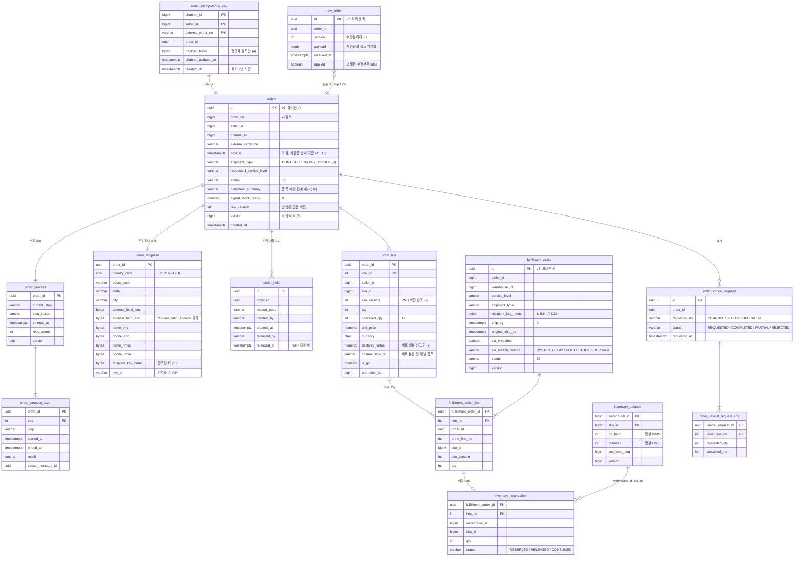

# OMS ERD (v1 초안)

> 근거: `README.md` 6.2 쟁점 1~18 결정. 괄호 안 숫자는 쟁점 번호. 컬럼 타입은 PostgreSQL 기준.
> 애그리거트 사이는 ID로만 참조하고 DB FK를 걸지 않는다(5). FK는 애그리거트 안에서만.

## 1. 모듈과 테이블

패키지는 도메인 최상위 분리(루트 README 결정)이고, 아래 모듈 = 도메인 패키지다.

| 모듈 | 테이블 | 파티션 |
|---|---|---|
| intake (수집) | `order_idempotency_key`, `raw_order` | 키 테이블은 없음(1), 원문은 `id` 월 범위(3) |
| order (주문 애그리거트) | `orders`, `order_line`, `order_recipient` | `order_id` 월 범위(5) |
| order 부속 | `order_hold`, `order_status_history`, `order_rule_application`, `order_cancel_request`, `order_cancel_request_line` | `order_id` 월 범위 |
| rule | `seller_rule` | 없음 |
| gift | `promotion`, `promotion_gift_grant` | 없음 / `order_id` 월 범위 |
| allocation | `allocation_decision`, `export_stock_wait` | `order_id` 월 범위 |
| inventory | `inventory_balance`, `inventory_reservation` | 없음 / `fulfillment_order_id` 월 범위 |
| fulfillment (출고 요청 애그리거트) | `fulfillment_order`, `fulfillment_order_line`, `fulfillment_order_status_history` | `fulfillment_order_id` 월 범위(13) |
| process | `order_process`, `order_process_step` | `order_id` 월 범위(18) |
| reference (OMS가 보유하는 기준 정보) | `channel`, `country`, `region_mapping`, `warehouse`, `warehouse_region_priority`, `warehouse_capability`, `business_calendar`, `service_level`, `channel_service_level_mapping` | 없음 |
| messaging (shared) | `outbox_event`, `command_outbox`, `inbox_message` | `id` 월 범위(오래된 파티션 통째로 삭제) |

- 월 범위 파티션의 키는 전부 UUID v7 id다. UUID v7 앞부분이 시각이라 id 범위 = 월 범위가 된다(1).
- PostgreSQL은 파티션 테이블의 PK, UNIQUE에 파티션 키가 들어가야 한다. 그래서 전역 유일이 필요한 것(채널 주문 멱등)은 파티션하지 않은 `order_idempotency_key`로 뺐다(1).
- 사람이 읽는 주문번호 `order_no`는 시퀀스로 발급한다. 파티션 테이블이라 UNIQUE 제약은 `(order_no, id)`만 가능하므로 유일성은 시퀀스가 보장한다.

## 2. 핵심 관계 (주문 - 출고 요청 - 재고)

## 3. 나머지 테이블

### 수집, 주문 부속
| 테이블 | 컬럼 | 쟁점 |
|---|---|---|
| `order_status_history` | `id`, `order_id`, `from_status`, `to_status`, `cause_message_id`, `actor`, `changed_at` | 16 |
| `order_rule_application` | `order_id`, `seller_rule_id`, `result`(jsonb), `applied_at`, `raw_version` | 10 |

### rule, gift
| 테이블 | 컬럼 | 쟁점 |
|---|---|---|
| `seller_rule` | `id`, `seller_id`, `rule_type`, `params`(jsonb), `priority`, `enabled` | 10. 합포장 켜기, 분할 끄기도 룰 종류(13, 14) |
| `promotion` | `id`, `seller_id`, `gift_sku_id`, `gift_sku_version`, `total_qty`, `granted_qty`, `starts_at`, `ends_at`, `version` | 11. 등록 시 FIFO 메시지 그룹 = `promotion_id` |
| `promotion_gift_grant` | `promotion_id`, `order_id`(PK 둘), `paid_at`, `result`(GRANTED / SOLD_OUT), `decided_at` | 11. 같은 주문 두 번 지급 방지 |

### allocation
| 테이블 | 컬럼 | 쟁점 |
|---|---|---|
| `allocation_decision` | `id`, `order_id`, `attempt`, `candidates`(jsonb: 창고별 탈락 사유), `chosen`(jsonb: 창고별 품목 수량), `decided_at` | 14 |
| `export_stock_wait` | `order_id`, `sku_id`(PK 둘), `qty`, `warehouse_id`, `transfer_request_id`, `status`(WAITING / ARRIVED) | 9. 이동은 SKU 수량 단위라 주문 하나에 여러 SKU가 기다릴 수 있음. 입고 완료 이벤트 -> 해당 SKU 행 ARRIVED -> 전부 ARRIVED면 `export_stock_ready` = T |

### fulfillment
| 테이블 | 컬럼 | 쟁점 |
|---|---|---|
| `fulfillment_order_status_history` | `id`, `fulfillment_order_id`, `from_status`, `to_status`, `cause_message_id`, `actor`, `changed_at` | 16 |

### reference
| 테이블 | 컬럼 | 쟁점 |
|---|---|---|
| `channel` | `id`, `code`, `adapter_type`, `sends_updated_at`, `sends_paid_at` | 4, 13 |
| `country` | `code`(PK), `requires_latin_address`, `deliverable`, `postal_code_pattern`, `required_fields`(jsonb), `duty_free_limit`, `duty_free_currency` | 8, 13(면세 한도) |
| `region_mapping` | `country_code`, `postal_prefix`(PK 둘), `region_id` | 8 |
| `warehouse` | `id`, `code`, `timezone`, `is_export`, `country_code` | 8, 9 |
| `warehouse_region_priority` | `warehouse_id`, `region_id`(PK 둘), `priority` | 8, 14 |
| `warehouse_capability` | `warehouse_id`, `region_id`, `service_level`(PK 셋), `available`, `carrier_departure`, `manifest_close`, `last_wave_release`, `order_cutoff`(전부 창고 현지 `time`), `updated_from_tms_at` | 8, 9, 13. TMS 커버리지 이벤트로 `available` 갱신 |
| `business_calendar` | `warehouse_id`, `date`(PK 둘), `is_business_day` | 9 |
| `service_level` | `code`(PK), `shipment_type` | 9 |
| `channel_service_level_mapping` | `channel_id`, `channel_value`(PK 둘), `service_level` | 9. 매핑 실패 = 보류 |

### messaging (shared)
| 테이블 | 컬럼 | 쟁점 |
|---|---|---|
| `outbox_event` | `id`(v7), `aggregate_type`, `aggregate_id`, `type`, `payload`(jsonb), `created_at`, `published_at` | 2, 18. 수집 발행과 OMS 이벤트 |
| `command_outbox` | `id`(v7), `target`(WMS / TMS), `fulfillment_order_id`, `command`, `idempotency_key`, `payload`(jsonb), `status`, `attempts`, `next_attempt_at`, `last_error`, `created_at` | 18, `docs/command-delivery.md` |
| `inbox_message` | `source`, `message_id`(PK 둘), `received_at` | 18 |

## 4. 인덱스 (조회 경로에서 나온 것만)

| 테이블 | 인덱스 | 쓰는 곳 |
|---|---|---|
| `orders` | `(seller_id, created_at)` | 셀러별 주문 목록 |
| `orders` | `(order_no)` | 사람이 주문번호로 찾기 |
| `order_recipient` | `(name_hmac)`, `(phone_hmac)` | 수취인 검색(5) |
| `order_hold` | `(order_id) WHERE released_at IS NULL` | 보류 여부 계산(12) |
| `fulfillment_order` | `(seller_id, warehouse_id, recipient_key_hmac, service_level, shipment_type, ship_by) WHERE status IN ('CREATED','SENT','ACCEPTED')` | 합포장 대상 찾기(13) |
| `fulfillment_order` | `(ship_by, status)` | 웨이브 직전 미전송 경보(13) |
| `fulfillment_order_line` | `(order_id)` | 주문에서 출고 요청 찾기(16 집계, 17 취소) |
| `order_process` | `(timeout_at) WHERE timeout_at IS NOT NULL` | 타임아웃 스케줄러(18) |
| `command_outbox` | `(next_attempt_at) WHERE status = 'PENDING'` | 디스패처(18) |
| `outbox_event` | `(created_at) WHERE published_at IS NULL` | 릴레이(2) |

- `order_line (order_id)`처럼 파티션 테이블에서 파티션 키가 아닌 컬럼으로 찾는 인덱스(예: `fulfillment_order_line (order_id)`)는 모든 파티션을 훑는다. 주문과 출고 요청은 같은 시기에 생기므로 조회 시 `fulfillment_order_id` 범위(주문 생성 월 이후)를 함께 주어 파티션을 줄인다.

## 5. ERD에서 새로 정한 것 (쟁점 결정에 없던 것)

| 항목 | 내용 |
|---|---|
| `export_stock_wait` | 9의 `transfer_request_id` 보관 위치. 주문 하나에 여러 SKU가 이동을 기다릴 수 있어 별도 테이블 |
| `promotion_gift_grant` | 11의 선착순 판정 결과. `(promotion_id, order_id)` PK로 같은 주문에 두 번 지급 방지 |
| `order_line.cancelled_qty`, `channel_line_ref`, `declared_value` | 17 부분 취소 누적, 7 세트 분할 추적과 신고가 배분 |
| `fulfillment_order_line`의 `sku_id`, `sku_version` | 주문 품목에서 복사. WMS 명령과 재고 예약이 주문 파티션을 다시 읽지 않게 |
| `fulfillment_order.recipient_key_hmac` | 합포장 키를 출고 요청에 두어 인덱스 하나로 대상 검색 |
| `warehouse_capability`의 시각 4개 | 9, 13의 출차 역산 구조를 컬럼으로 |
| `country.duty_free_limit` | 13의 해외 합포장 면세 한도 조건 |
| `channel.sends_updated_at`, `sends_paid_at` | 4(b) 순서 반영 방식, 13 마감 판정 대체 기준 선택 |
