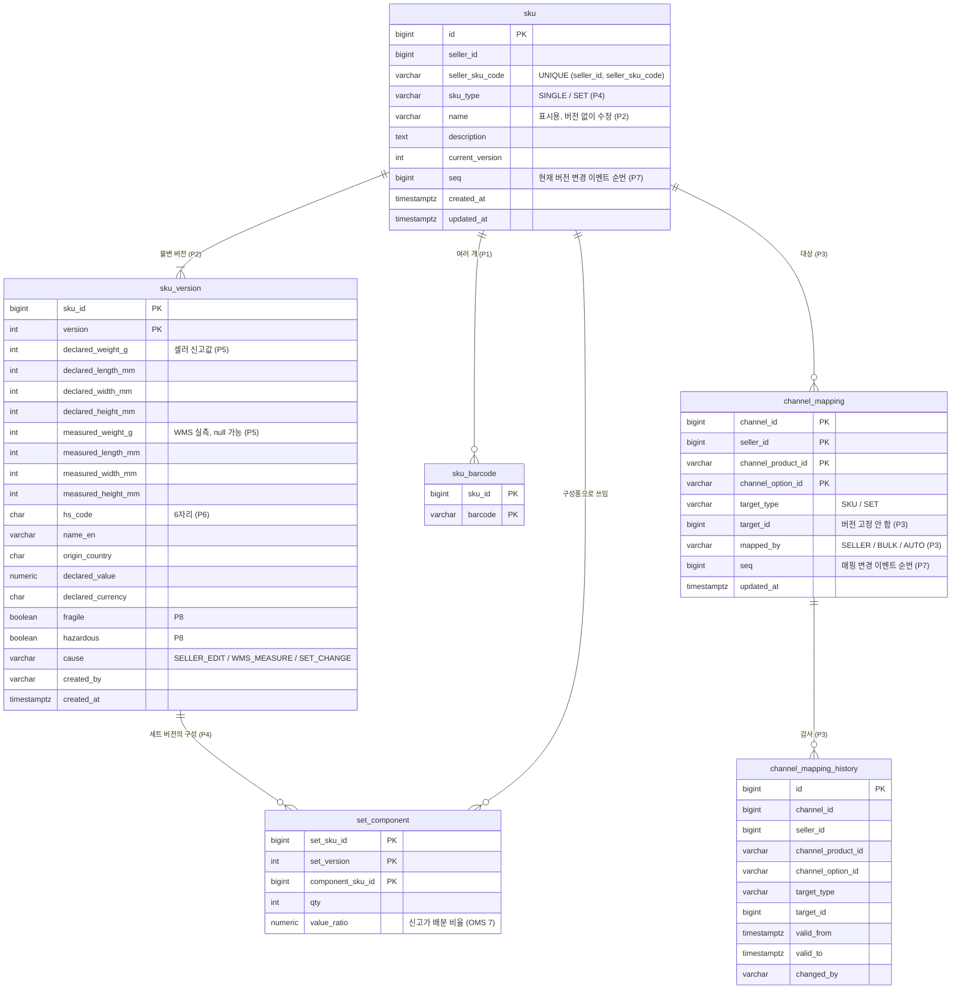

# PMS ERD (v1 초안)

> 근거: `README.md` 2절 쟁점 P1~P8 결정. 괄호 안은 쟁점 번호. PostgreSQL 기준.
> PMS 데이터량은 주문에 비해 작다(셀러 x SKU 수). 파티션은 두지 않는다.

## 1. 테이블과 단계

| 단계 | 테이블 |
|---|---|
| S1 | `sku`, `sku_version`, `sku_barcode`, `channel_mapping` |
| S2 | `outbox_event`, `inbox_message`(WMS 실측 이벤트 수신) |
| S4 | `set_component` |
| S5 | `channel_mapping_history` |

## 2. 관계

## 3. 메모

- **불변 보장**: `sku_version`은 INSERT만 한다. 애플리케이션에서 UPDATE 경로를 두지 않고, DB에서는 UPDATE 트리거로 거부한다(P2).
- **새 버전 만들기**: 셀러 수정, WMS 실측 이벤트, 세트 구성 변경은 같은 경로를 탄다. 현재 버전을 복사하고 바뀐 필드만 바꿔 `version + 1`로 INSERT, `sku.current_version`과 `sku.seq` 갱신, outbox에 현재 버전 변경 이벤트. 셋 다 한 트랜잭션. 동시 수정은 `sku` 행 갱신 충돌로 막는다(`seq` 조건부 UPDATE).
- **유효 무게, 크기**: 실측값이 있으면 실측값, 없으면 신고값(P5). 컬럼으로 두지 않고 읽을 때 계산.
- **세트 구성품 버전**: `set_component`는 구성품의 `sku_id`만 가리킨다. OMS가 세트를 나눌 때 구성품 버전은 그 시점의 현재 버전으로 정한다(P3와 같은 원리).
- **이벤트 순번**: 전역 순번이 아니라 행(키)별 순번이다. 받는 쪽은 같은 키에서 더 큰 순번만 반영하면 된다(P7, OMS 15와 같은 방식).
- **바코드**: 같은 국제 바코드(EAN)를 여러 셀러가 팔 수 있어서 바코드만으로는 유일하지 않다. PK는 `(sku_id, barcode)`이고, `barcode` 단독 인덱스로 찾되 셀러로 좁힌다. WMS 입고 스캔 시 셀러 문맥이 필요하다(WMS 설계 때 확인).
- **조회 API**: `GET /skus/{id}/versions/{version}` 응답은 불변이라 `Cache-Control: immutable`. 받는 쪽은 무기한 캐시(P7).

## 4. ERD에서 새로 정한 것

| 항목 | 내용 |
|---|---|
| `sku.seq`, `channel_mapping.seq` | P7 이벤트 순번을 행별로 둠 |
| `sku_version.cause` | 새 버전이 생긴 이유(셀러 수정 / 실측 / 세트 구성 변경) |
| `sku_version` UPDATE 거부 트리거 | P2 불변을 DB에서도 강제 |
| `set_component`는 구성품 `sku_id`만 | 구성품 버전은 OMS가 세트를 나눌 때 정함 |
| `sku_barcode` PK `(sku_id, barcode)` | 같은 바코드를 여러 셀러가 쓸 수 있음 |
| `channel_mapping.mapped_by` | P3 자동 매핑과 수동 등록 구분 |
